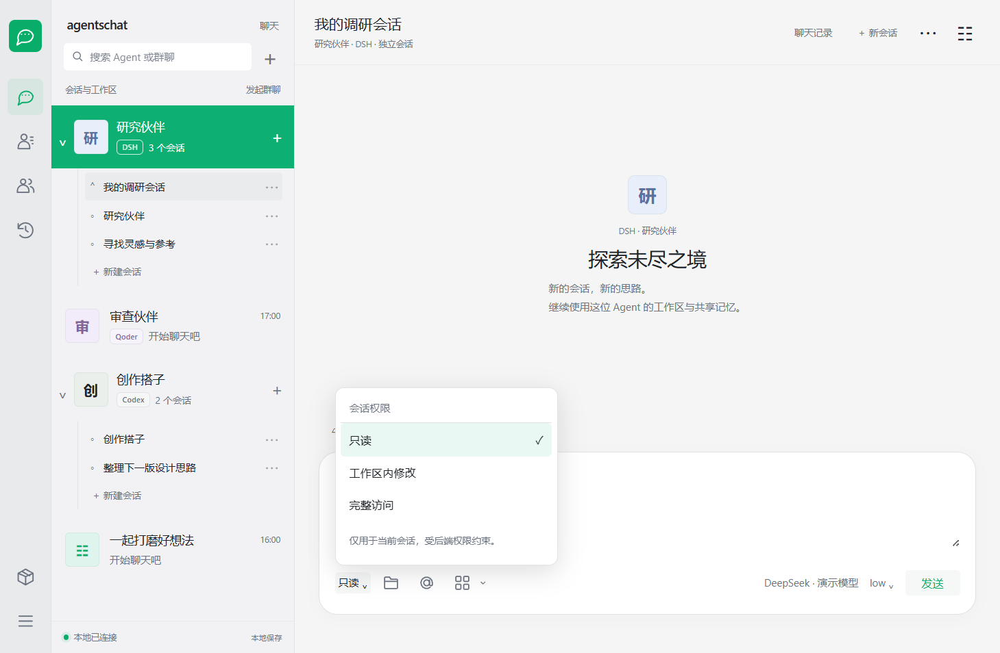
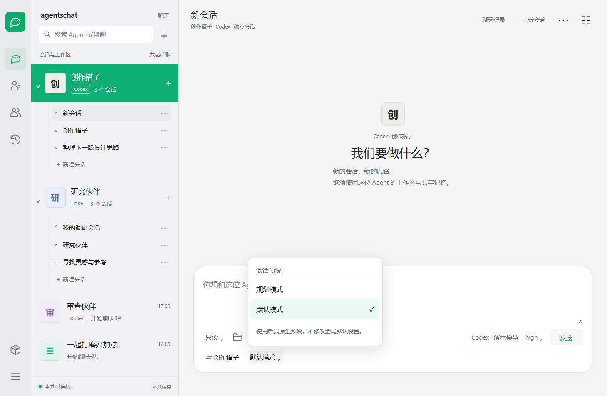

# agentschat

把不同 AI Agent 放进同一个聊天室的本地应用。每位 Agent 保持自己的工作区与 Room 记忆，既可以单独对话，也可以加入群聊，与来自不同 harness 的伙伴一起讨论。

提供 Windows 桌面版与浏览器界面，聊天记录和工作区保存在本机。

## 项目特点：每位 Agent 都有自己的工作区

**同一个 harness，也能拥有多位工作区独立的 Agent。** 例如创建两位 Claude Code Agent，分别担任开发与审查伙伴：它们使用不同的工作目录，Room 管理的记忆也分别保存。每位 Agent 加入不同群聊后，仍保持自己的身份、工作区和记忆。

| 场景 | 工作区 | Room 管理的记忆 | 原生会话 |
| --- | --- | --- | --- |
| 不同 Agent，即使使用相同 harness | 各自独立 | 按 Agent 分别保存 | 各自独立 |
| 同一 Agent，跨单聊和不同群聊 | 保持同一目录 | 跨会话共享，遵守消息可见范围 | 每个单聊/群聊分别创建 |

新建或修改工作区会检查目录重复、相互包含及链接别名；已有聊天和独立工作区继续保留。旧共享目录保留原文件，并提示选择独立目录后继续使用。

这里的记忆隔离范围是 agentschat 自管数据；各 harness 原生的全局/项目记忆仍需分别适配和验证。具体存储、升级与权限边界见[记忆、会话与工作区](#记忆会话与工作区)。

## 界面预览


0.1.34 的隔离演示数据，展示三栏导航、会话列表、绿色消息气泡与底部输入区；消息为界面测试样例，不是真实模型回复。

<details>
<summary>查看旧版用户截图</summary>


原样保留用户提供的旧版实际使用截图，供历史对照。

</details>

## 0.1.36 Qoder 多会话与 ZCode 桌面账号接入

- Qoder 与 ZCode 现在拥有和 Codex/DSH 相同的 Agent 展开、多会话、新建、命名、置顶、草稿与附件隔离入口；同一 Agent 继续共享工作区和 Room 记忆。
- Qoder 读取实际 ACP 模式目录，按会话应用并校验回显。新会话默认“逐次确认”，跳过权限确认需要用户明确确认；这些是原生权限策略，不是操作系统沙箱。
- ZCode 实验性支持 **Windows 桌面 3.16.3**：复用安装自带 Host、RPC 与 Agent 运行时，由原生宿主读取当前桌面账号及模型权限，不复制凭据到 Room。支持固定模型、原生推理档位、流式回复和逐次审批；首版只开放可核验的 `build` 模式。其他桌面版本明确报不兼容。
- Qoder CN 0.4.11 已完成真实回复；ZCode 当前 Start Plan 的 GLM-5.3-Flash 已完成真实回复和 Qoder/ZCode 混合群验收。GLM-5.3 在本次检查中返回 `429 / 3009` 并发限制；程序按所选模型报错，不静默换模型或重发。
- 原生桌面列表可见性、ZCode 的规划开关、桌面电脑操作以及 ZCode MCP 投票尚未专项验收。已有会话不自动迁移权限，现有安装不会因构建新包自动更新。

实现与证据边界见 [ZCode / Qoder 接入说明](docs/ZCODE_QODER_INTEGRATION.md)。

## 0.1.35 原生权限与预设控件

- 修复选中 Agent 在悬停/键盘聚焦时出现灰色内块与白字对比不足的问题。
- 新建 DSH 对话采用上方“工作区 + 预设”、输入卡片下方“权限 + 附件/工具 + 模型/推理”的布局；Codex 使用自己的默认/规划模式与权限选项。点击预设、权限、推理档位可直接下拉选择。
- DSH 通过独立 ACP 子进程里的原生服务读取安装自带预设和权限，不修改 DSH 全局配置；当前实测标准、程序化工具、精简预设及只读/工作区内修改/完整访问。缺少依赖的预设禁用并显示原因，不自动替换。桌面自定义预设尚未同步。
- Codex 从本机 app-server 读取协作模式和管理约束，按会话传递 sandbox、approvalPolicy 和 collaborationMode。权限选项受后端策略约束。
- 新建会话默认只读；原有会话保留旧配置，首次选择后仅更新该会话。预设在首条消息前可选，已有内容需新建会话更换预设；修改权限需等待回复结束。模型仍随 Agent 固定，推理档位按会话调整。
- 原生权限请求显示“允许这一次 / 拒绝”，回复结束、停止、会话释放或超时自动拒绝未决请求；完整访问需明确确认。群聊及其他 harness 不改变现有权限规则。

能力目录与原生空会话已经实测；没有发起真实模型回复或文件执行验收。工作区不存在时会提示先选择有效目录，不恢复删除的目录。

<details>
<summary>查看 DSH 与 Codex 原生配置菜单</summary>





0.1.35 打包程序，使用隔离演示 Agent 和真实后端能力目录，无模型生成。

</details>

## 0.1.34 微信风格界面与项目改名

- 项目显示名、桌面窗口、应用菜单、新安装快捷方式与安装包统一为 **agentschat**。
- 窄导航栏 + 会话列表 + 聊天区三栏布局；绿色选中态、浅灰背景、方形头像与绿色消息气泡，输入区贴底显示。
- 左侧入口分别查看全部聊天、Agents 和群聊，底部打开后端管理和外观设置。保留 Codex / DSH 的展开会话、新建、重命名、置顶及各自输入选项。
- 为兼容旧安装，保留 `com.mocias.agentroom` 安装标识、`Agent Room.exe` 程序文件名、`%APPDATA%/Agent Room` 数据定位和已有 `AGENT_ROOM_*` 配置；不自动移动个人数据或工作区。精确增量升级继续使用旧快捷方式，新安装快捷方式显示 agentschat。
- GitHub 仓库已改名为 [mocias/agentschat](https://github.com/mocias/agentschat)，本地源码目录沿用原名。DSH 宿主要求包名与客户端注册 ID 一致，因此内部 npm 包名、插件 ID 保留 `dsh-agent-room`，路由和数据键也保留兼容；产品显示名称使用 agentschat。

## 0.1.33 Agent 下的多个会话（Codex / DSH）

- 点击 Codex 或 DSH Agent 展开历史会话，点击箭头收起；Agent 旁的 **＋**、列表内的“新建会话”和聊天顶部入口都可以开始新对话。
- 每个会话拥有独立历史、当前上下文与推理设置，继续使用所属 Agent 的工作区和共享记忆。首次发送才创建后端会话；浏览历史和新建空会话不请求模型生成。
- 新会话以首条消息自动命名，也可通过会话旁的 **⋯** 重命名、置顶。会话标题与 Agent 名称分别管理；切换时保留各自草稿和附件，重开应用恢复已选会话及展开状态（未发送草稿与附件只在当前窗口内保留）。
- Codex 使用底部工作区栏与工具/模型布局；DSH 使用上方工作区栏、下方模型/推理布局。点击模型或推理档位进入设置，模型仍随 Agent 固定，推理档位依据后端实际返回的选项校验。
- 0.1.33 第一版仅适配 Codex、DSH；群聊和其他 harness 保持原有界面。这里只展示 agentschat 保存的聊天，不自动导入原生桌面中的其他历史，不提供尚未接入的语音或插件；权限与预设切换已在 0.1.35 接入，见上文。会话重启仍沿用现有历史恢复机制，不承诺原生会话 ID 跨重启保持不变。

## 0.1.32 Agent 共享记忆

- 同一 Agent 跨单聊和群聊共享持久记忆，不同 Agent 即使使用同一 harness，也各有独立记忆和工作区。
- 已有聊天自动回填到该 Agent 的记忆，不改写原聊天记录，不搬动或删除工作区文件。
- Agent 设置新增“查看共享记忆”，可搜索内容并查看来源会话、发送者与时间。
- 新建/修改工作区拒绝重复、嵌套和链接别名；旧共享目录保留并提示处理，不自动迁移。

## 0.1.31 界面更新

- 优化会话列表、聊天气泡、输入卡片、欢迎页与设置弹窗，完善深色主题及窄窗口适配。
- 外观设置增加主题预览，支持保存和恢复自定义背景色。
- Agent 列表和消息署名显示 harness 标识，群聊展示成员使用的 harness，支持按 harness 名称搜索会话。

## 0.1.29 修复

- 消息提交后立即解除发送锁；模型思考期间可继续发送、点名其他成员或补充当前请求。保留原有 Codex 引导当前轮、ACP 取消并接续的行为。
- Claude 添加 Agent 时只核对返回的模型列表，避免模型查询额外触发 `set_model` 和上游限流；实际聊天仍严格应用固定模型，不自动换模型。
- WorkBuddy 显示脱敏后的具体拒绝原因（例如 `Quota exceeded: 429 too many requests`），不再只显示笼统的 refusal。上游额度与限流仍需由后端恢复。

## 功能

- **多 Agent 单聊与群聊**：为 Agent 设置名称、角色和工作区，同一个 harness 可以添加多个 Agent。
- **每位 Agent 独立工作区**：分别分配目录，防止同 harness 的不同 Agent 误用同一工作区；同一 Agent 跨群聊继续使用自己的目录。
- **公开讨论与私聊**：使用 @ 提及成员或所有人；以 #成员 开头的消息仅发送给私聊双方，用户可以查看全部消息。
- **模型选择**：创建 Agent 时选择模型；支持按会话调整推理强度，具体选项取决于 harness。
- **历史记录搜索与导出**：在全部会话或指定会话中搜索正文、发送者和附件名称；群聊与单 Agent 聊天均可导出为 Markdown 或 JSON，保留时间与私聊标记。
- **会话管理**：搜索、重命名、置顶和删除会话，支持查看群成员。
- **文件与图片**：支持添加附件，具体识别能力取决于所选 harness 和模型。
- **闹钟提醒**：在输入栏“工具”菜单中查看和管理闹钟，支持公开或私密提醒。应用关闭期间到期的提醒会在重新运行后补发。
- **群聊投票**：每位 Agent 可通过原生 MCP 工具发起命题并提供 2–10 个选项；用户也可在“工具 → 投票”创建或管理。支持公开记名和匿名投票、单选、改票、弃权、截止、提前结束及取消。创建时的全部 Agent（包括发起者）参与，用户不计票；全员完成后自动结算。
- **个性化外观**：切换主题、调整颜色和聊天背景，支持流式显示回复。
- **本地数据管理**：自选数据目录并自动迁移，为 Agent 指定工作区。
- **Agent 共享记忆**：同一 Agent 跨单聊和群聊自动积累、检索自己的记忆；不同 Agent 分别保存。
- **后端管理**：自动发现或手动选择本机 harness，支持为部分后端单独配置代理。
- **增量更新**：使用匹配当前版本的更新包升级，无需卸载，保留聊天数据和工作区。

## 记忆、会话与工作区

独立桌面/浏览器版从 0.1.32 起，在 Room 数据目录的 `memory/<Agent ID 的哈希>/messages.jsonl` 按稳定 Agent ID 保存记忆。同一 Agent 在各单聊和群聊中有权接收的普通消息及自己的回复，自动进入同一份记忆；改名或更换工作区不改变归属。两个 CC Agent 的目录和记忆分别维护，不因使用同一 harness 而合并。各群仍分别创建原生 CLI/ACP 会话。

首次启动会从已有的 Room 聊天记录回填记忆，重复启动不重复记入，也不改写原记录。每轮使用本地关键词、中文词片段和最近记录检索，最多提供约 12 条、12000 字符的上下文，不把全部记忆每次重发。保存和检索不调用模型、embedding 或额外 API；提供给模型的记忆片段计入正常聊天输入，仍使用所选 harness 的额度。这是带来源的历史记录检索，不保证语义近义召回，也不把历史发言自动认定为事实。

在单聊顶部的 Agent 设置，或群成员的 Agent 设置中，点击“查看共享记忆”即可查看与搜索。普通单聊记录可供同一 Agent 在群聊中继续使用；显式 `#成员` 私聊只会在接收范围不会扩大的会话中召回。其他 Agent 无权收到的私聊、投票原始工具调用和匿名个人选票不会进入其可召回记忆。删除群聊会保留已经积累的 Agent 记忆；删除 Agent 默认保留磁盘记忆，与已有历史记录一样留在本地，新建同名 Agent 使用新身份，不继承旧记忆。

已有独立工作区保持原路径和内容。若旧配置有重复/嵌套目录，相关 Agent 会暂停生成并提示选择独立目录；可在 Agent 设置中处理，原文件不会自动搬移或删除。工作区校验和 Room 记忆命名空间不等同于操作系统沙箱；各 harness 的账号与全局配置仍由原应用管理，原生记忆能力另行验证。旧 DSH 插件宿主尚未接入这份 Room 记忆服务。

## 投票使用与隐私

在群内要求 Agent “发起一次匿名/公开投票”即可；平台通过 MCP 提供 `poll_create`、`poll_list`、`poll_get`、`poll_vote`、`poll_abstain`、`poll_close`、`poll_cancel`，不是解析普通聊天中的选项文字。也可通过输入栏“工具 → 投票”直接创建。发起后平台安排每位成员独立投票，忙碌成员等当前消息处理完再参与。没有回应不等于弃权。

公开投票展示票数及成员选择。匿名投票仅展示完成数量，结束后公布汇总，不向 Room 界面、其他 Agent、推送和历史导出提供选票与身份的对应关系；调用者只能查询自己的选择。匿名投票轮次不展示生成过程或文字回复，工具参数不会写入 Room 聊天记录。取消的匿名投票不公布选票。

这是应用层匿名，不是对本机管理员的加密匿名：`polls.json` 内部保存选票归属以支持改票和去重，后端原生会话也可能保留工具调用。Agent 自己主动在普通聊天中透露选择不在平台的匿名保证范围内。

投票创建后不能修改命题、选项或匿名方式。默认表单期限为 10 分钟，工具允许 30 秒至 7 天；每名成员自动邀请最多两次，界面可重试邀请。点击“停止回复”会暂停当前群的自动邀请，点击“重试邀请”恢复；截止仍有效。退出期间不运行模型，重启后恢复未完成事项并结算过期投票。已提交的选票不会因模型回复中断而撤销，投票结果不会自动执行方案。

投票数据随 Room 数据目录保存和迁移。工具连接仅绑定当前群和当前 Agent，不允许代投或跨群操作；不修改各后端的全局 MCP 配置。当前实现接入独立浏览器/桌面版，旧 DSH 插件宿主未接入时会明确提示不可用。

## Harness 适配

| Harness | 适配情况 | 使用说明 |
| --- | --- | --- |
| Codex | 已适配 | 使用本机 Codex，支持单聊、群聊、模型选择和后端提供的推理档位。 |
| DSH | 已适配 | 使用本机 DSH，支持单聊、群聊及后端提供的模型与推理选项。 |
| Qoder | 已适配 | 使用本机 Qoder，支持单聊、群聊及后端提供的模型与推理选项。 |
| ZCode | 实验性适配 | Windows 桌面 3.16.3；复用当前桌面账号，支持单聊、混合群、多会话、模型和原生推理档位。 |
| Claude Code | 已适配 | 支持终端版，也可使用已配置 Gateway API 的 Claude 桌面 Code；当前为文本聊天，不支持推理档位调整。 |
| WorkBuddy 国内版 | 实验性适配 | 需在同一 Windows 用户下保持桌面应用已登录运行；跨用户连接暂不支持。 |
| WorkBuddy AI 国际版 | 实验性适配 | 复用桌面登录，支持独立会话和具体模型选择；适配桌面版本 5.8.4。 |

各 harness 需自行安装并登录，模型权限与用量由对应服务管理。WorkBuddy 模型列表读取桌面保存的在线目录快照，可点击“重新读取模型”同步；暂不包含自定义模型和套餐灰显提示。agentschat 中的会话不保证同步显示在各 harness 的原生桌面任务列表中。

### 后续接入与开放贡献

欢迎外部开发者 Fork 并提交 PR，由维护者审核合并。新增 harness 的计划独立于上面的已适配清单，以下项目均尚未接入：

| 批次 | 候选应用 |
| --- | --- |
| 优先验证 | OpenCode、Qwen Code、Kimi Code CLI、GitHub Copilot CLI |
| 后续扩展 | CodeBuddy Code CLI、Cursor CLI、Goose、Mistral Vibe、Auggie、Factory Droid |
| 条件调研 / 社区候选 | Gemini CLI、Google Antigravity CLI、Kiro CLI、OpenHands、Pi、Aider |

完整依据、版本迁移提醒、优化优先级与认领方式见 [路线图](ROADMAP.md)。实现或测试适配前请读 [贡献指南](CONTRIBUTING.md) 和 [接入验收指南](docs/HARNESS_INTEGRATION.md)；可通过 [harness 提案](https://github.com/mocias/agentschat/issues/new?template=harness_request.yml) 参与。GitHub 上的相似项目及可借鉴方向见 [项目调研](docs/SIMILAR_PROJECTS.md)。

### 桌面工作区登记（0.1.28）

在 Agent 设置中点击“检查桌面登记”查看实际登记状态。工作区登记与 ACP 对话导入分开报告；检查不会重启任何应用。

- **DSH**：桥接随 agentschat 交付，自动复制到 DSH 桌面配置目录并添加受标记管理的配置段，无需用户单独安装旧群聊插件。使用原生 `workspaceRegistry` 登记目录和已有会话；DSH 加载配置或重启后生效。兼容迁移旧插件中指向同一 Room 的桥接设置，其余配置保留。
- **Codex**：自动创建或复用后端项目，通过原生接口核对对话归属，并持久化桌面登记队列。保持 agentschat 运行，在 Codex 完全退出后合并 `.codex-global-state.json` 的项目、顺序和对话映射，重新打开 Codex 查看。不必手动添加目录。进程检测失败、文件损坏或映射冲突时停止写入并报告错误；修改前备份，不修改信任和权限设置。
- **Qoder（按 CN 0.4.8 验证）**：自动复用原生工作区；没有时排队，在完全退出 Qoder（包括托盘）后，备份并事务写入 `main.sqlite` 工作区索引。重启后直接显示，无需手动添加文件夹；已用新空目录完成真实桌面重启验证。不会恢复用户已归档或删除的工作区。原 ACP 对话历史尚未导入。
- **WorkBuddy（实验性，按 AI 5.8.4 验证）**：自动复用当前目录的原生任务；没有任务时排队，完全退出 WorkBuddy（包括托盘）后创建空的“agentschat 工作区登记”任务，不发送模型消息。使用数据库备份、事务和字段校验，不伪造历史消息。已完成新空任务的真实桌面重启显示和打开验证；ACP 历史仍独立保存。首次需正常安装、登录并生成账号快照；仅有唯一账号时自动绑定，多个账号要求明确绑定。国内版共用适配逻辑，尚未做同版本真实桌面验证。
- **Claude Code（按 Claude 桌面 2.42304 Gateway 模式验证）**：选择兼容的 Claude 桌面入口并正常打开 Code 页面后，Room 识别其本地账号/组织目录，排队通过原生 `claude://resume?session=...` 入口导入已有 CLI 会话。原生工作区与原聊天内容均已实际显示。桌面需已打开，对应 CLI 会话须已退出；运行中的 Room 会话不被强行接管。无需发送占位消息，不直接伪造桌面会话文件。API 配置 ID 与会话组织 ID 分开识别；多账号时要求明确绑定。仅配置独立 CLI 时保留 `cli-only` 状态，暂不支持订阅版桌面自动发现。

Qoder、WorkBuddy 和 Claude 的索引路径保存在 Room 数据目录的 `desktop-sync/bindings.json`，更换安装版本或账号后需更新绑定。例如：

```json
{
  "qoder": { "databaseFile": "C:/Users/USER/AppData/Roaming/com.qodercn.app.stable/main.sqlite" },
  "workbuddy-ai": { "snapshotFile": "C:/Users/USER/.workbuddy-ai/ACCOUNT_ID/sidebar-list-snapshot.json" }
}
```

agentschat 启动、添加 Agent、产生原生会话及更换目录时会安排登记。登记由 agentschat 内部定时处理，需要保持程序运行。关闭时停止安排新的登记，待处理任务保存在 `desktop-sync/*-pending.json`，下次打开后继续；不会启动独立后台登记进程。升级时会停止 0.1.27 遗留的登记进程并保留队列。已登记的工作区和聊天记录不受影响。DSH 仍由内置桥接在自身启动时读取登记。

Codex、WorkBuddy、Qoder 必须完全退出（包括托盘），为安全写入留出通常数秒的空档；如果退出后立刻打开，可能错过空档并延后到下次退出，不能保证任意速度的重启都能赶上。Claude 等待桌面打开且原 CLI 会话退出。此版本不安装系统服务或开机自启项；如果电脑关机中断了待处理任务，下次启动 agentschat 后恢复。修改前保留 `*.before-agent-room-*` 备份。

`node scripts/check-desktop-registrations.cjs <Room data>` 会执行登记（不是只读检查）：安装 DSH 桥接、核对 Codex 原生归属并排队退出后处理。关闭 agentschat 后加 `--save` 还可更新 Room 状态缓存，保留原 catalog 备份。

## 下载

前往 [GitHub Releases](https://github.com/mocias/agentschat/releases/latest) 下载 Windows x64 安装包。已有用户可以覆盖安装，或使用与当前版本匹配的增量更新包。

## 许可

基于 [dsh-agent-room](https://github.com/mocias/dsh-agent-room)，采用 [MIT 许可证](LICENSE)。
